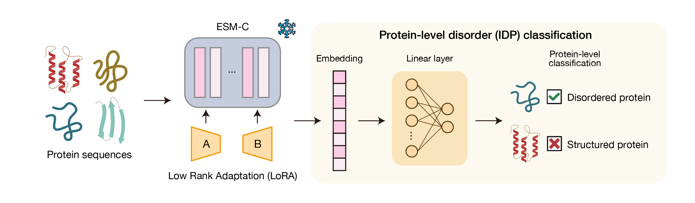

# ATHENA

This repository provides the official implementation for the core structural disorder prediction components of the ATHENA (AI-driven Tardigrade resistome High-throughput Exploration and Novel Annotation) framework. ATHENA is an integrated AI framework engineered to predict a protein's 'stress-resistance potential' directly from its primary sequence.


While the full ATHENA framework is designed to predict multiple properties, its primary function and core component is the accurate prediction of structural disorder—a key feature of many stress-response proteins (e.g., tardigrade effectors). This repository provides the two-tiered classification system for this task:

1.  A state-of-the-art residue-level classifier for mapping intrinsically disordered regions (IDRs).
2.  A protein-level classifier for predicting the likelihood of being globally disordered.


## Overview

The discovery of novel 'guardian' proteins, such as those that give tardigrades their remarkable resilience to extreme environments, is a significant challenge. Many of these key effectors are intrinsically disordered proteins (IDPs). Unlike structured proteins, IDPs lack a stable 3D fold, and their sequences often evolve rapidly. This makes them difficult to identify using traditional homology-based computational methods, which rely on sequence or structure conservation.

To overcome this challenge, we developed the ATHENA framework. The models provided here are focused on identifying structural disorder by capturing the subtle sequence features indicative of this property. The models are built upon protein language model (PLM) embeddings (ESM-C); the protein-level IDP classifier is fine-tuned using Low-Rank Adaptation (LoRA) to specialize in this complex prediction task.

## Key Features

This repository provides two distinct, state-of-the-art models:

* **Residue-Level IDR Classifier:**
    * Provides fine-grained prediction, mapping the precise boundaries of intrinsically disordered regions (IDRs) within a protein sequence.
    * Employs a dual-stream fusion architecture, combining **ESM-C** protein language model embeddings with **Boltz-2** structure prediction features.
    * Uses **Bilinear Cross-Attention** between the sequence and structure streams, with **Bi-directional GRU (BiGRU)** blocks for local context and an **MLP** classification head.


* **Protein-Level IDP Classifier:**
    * Predicts a protein's overall 'stress-resistance potential' (the **ATHENA score**), which correlates with its likelihood of being a globally disordered protein.
    * Built on embeddings from the **ESM-C** Protein Language Model (PLM), used through its Hugging Face port ESM++ (`Synthyra/ESMplusplus_small`, ESM-C 300m).
    * Uses **Low-Rank Adaptation (LoRA)** fine-tuning to specialize the PLM for accurately distinguishing disordered from structured proteins.



## Prerequisites

**Git and Git LFS must be installed before cloning.** The IDR model weights and example embeddings are stored with [Git LFS](https://git-lfs.com/); without it, `git clone` downloads only small pointer files and `git lfs` reports `'lfs' is not a git command`.

* [Git](https://git-scm.com/)
* [Git LFS](https://git-lfs.com/) — macOS: `brew install git-lfs`; Ubuntu/Debian: `sudo apt install git-lfs`; Windows: installer from git-lfs.com; conda: `conda install -c conda-forge git-lfs`. Then run `git lfs install` once.
* [Conda](https://docs.conda.io/) (Miniconda or Anaconda) to create the environment below

The basic Python requirements are:

* python=3.10
* torch==2.5.1
* numpy==2.0.1
* transformers==4.48.1
* peft==0.15.2
* pandas==2.2.3

Details on system requirements and the full dependency list is contained in the following file: environment.yml

## Installation

**Clone this repository:**
Git and Git LFS must already be installed (see Prerequisites):
```
git lfs install
git clone https://github.com/Shimizu-team/ATHENA.git
cd ATHENA
git lfs pull
```
Check that `ATHENA_IDR_Classifier/weights/best_model.pt` is about 92 MB. If it is only ~130 bytes, the LFS files were not downloaded; run `git lfs pull` again.

**Construct environment:**
You can set up the required environment using the environment.yml file:
```
conda env create -f environment.yml
conda activate ATHENA
```
Typical install time on a standard desktop computer: 5-15 minutes, depending on network speed

## Usage

Two Jupyter notebooks are provided, one per classifier:

* **Residue-level IDR classifier:** `ATHENA_IDR_Classifier/notebooks/Colab_Demo.ipynb` [](https://colab.research.google.com/github/Shimizu-team/ATHENA/blob/main/ATHENA_IDR_Classifier/notebooks/Colab_Demo.ipynb)
* **Protein-level IDP classifier:** `ATHENA_IDP_Classifier/notebooks/Colab_Demo.ipynb` [](https://colab.research.google.com/github/Shimizu-team/ATHENA/blob/main/ATHENA_IDP_Classifier/notebooks/Colab_Demo.ipynb)

Alternatively, run the scripts from the command line as described in "How to Run" below.

Expected runtime: ~3-5 minutes including installation

### Input Files

The primary input for both classifiers is a standard multi-FASTA file (e.g., `example_sequences.fasta`). The parsers in the scripts are designed to extract sequence IDs from UniProt-style headers (like `>sp|P12345|...`) or simple headers (like `>my_protein_id_1`).

Example input files are bundled with each classifier:

* `ATHENA_IDR_Classifier/data/example_sequences.fasta` (50 proteins, with matching pre-computed features)
* `ATHENA_IDP_Classifier/data/example_sequences.fasta`

**Example FASTA:**
```fasta
>sp|P12345|PROT1_HUMAN Fictitious protein alpha
MTEYKLVVVGAGGVGKSALTIQLIQNHFVDEYDPTIEDSYRKQVEVDCQQCMLEILDT
...
>protein_sample_02
MVHLTPEEKSAVTALWGKVNVDEVGGEALGRLLVVYPWTQRFFESFGDLSTPDAVMGN
...
```

### How to Run:

**1. Residue-Level Classification (Mapping IDRs)**

Expected run time for demo on a standard desktop computer: Anywhere from 1-10 minutes, depending on the number of sequences to be classified.

The IDR classifier requires three inputs with **matching protein IDs** across all of them:

1. **FASTA file** — standard format (`>PROTEIN_ID\nSEQUENCE`)
2. **ESM-C embeddings** — a `.pt` file containing a dict of `{protein_id: tensor[L, 960]}` (must use ESM-C **300m**)
3. **Boltz-2 features** — a directory of per-protein subdirectories containing structure prediction outputs

Run inference using the `predict.py` script inside `ATHENA_IDR_Classifier/`. Starting from the repository root:

```
cd ATHENA_IDR_Classifier

python predict.py \
    --fasta data/example_sequences.fasta \
    --embeddings data/embeddings/example_esmc_300m.pt \
    --boltz-dir data/boltz2_predictions/predictions \
    --output-dir output/
```

To predict specific proteins only (still inside `ATHENA_IDR_Classifier/`):

```
python predict.py \
    --fasta data/example_sequences.fasta \
    --embeddings data/embeddings/example_esmc_300m.pt \
    --boltz-dir data/boltz2_predictions/predictions \
    --protein-ids DP03748 DP03749 \
    --output-dir output/
```

**Command-Line Options:**

| Option | Default | Description |
|--------|---------|-------------|
| `--fasta` | (required) | FASTA file with query sequences |
| `--embeddings` | (required) | Pre-computed ESM-C embeddings `.pt` file |
| `--boltz-dir` | (required) | Boltz-2 predictions directory |
| `--checkpoint` | `weights/best_model.pt` | Model checkpoint path |
| `--protein-ids` | all | Specific protein IDs to predict |
| `--output-dir` | `./output` | Output directory |
| `--batch-size` | 8 | Inference batch size |
| `--threshold` | auto (0.4302) | Classification threshold |
| `--format` | both | Output format: json, tsv, or both |

**Preparing inputs for your own proteins:**

To run predictions on new proteins, you need to pre-compute both ESM-C embeddings and Boltz-2 features.

**2. Protein-Level IDP Classification**

Expected run time for demo on a standard desktop computer: Anywhere from 1-10 minutes, depending on the number of sequences to be scored.

The model parameters are shipped as a zip archive and must be extracted once. The base model (`Synthyra/ESMplusplus_small`) is downloaded from Hugging Face on the first run, so an internet connection is required. The script pins the base model to the Hugging Face revision the adapter was trained with (`DEFAULT_BASE_MODEL_REVISION` in `config.py`, overridable with `--base_model_revision`), because later revisions pool differently ([CLS] + mean is required) and need newer library versions. Use the `transformers` and `peft` versions listed in Prerequisites.

Starting from the repository root (if you are still inside `ATHENA_IDR_Classifier/`, run `cd ..` first):

```
cd ATHENA_IDP_Classifier
unzip -o ATHENA_IDP_model_params/ATHENA_IDP_model_params.zip -d ATHENA_IDP_model_params

python ATHENA_IDP_classification.py --title "IDP_Inference" \
                    --adapter_paths "IDP_LoRA=ATHENA_IDP_model_params" \
                    --output_type "before_softmax" \
                    --batch_size 64 \
                    --fasta_path "data/example_sequences.fasta"
```
This script executes ATHENA_IDP_classification.py with specific arguments:

* **--fasta_path** "data/example_sequences.fasta": Specifies your input FASTA file.

* **--adapter_paths** "IDP_LoRA=ATHENA_IDP_model_params" (required): Loads the LoRA adapter from the ATHENA_IDP_model_params/ directory (`adapter_config.json`, `adapter_model.safetensors`) under the name "IDP_LoRA". The adapter also contains the trained classification head (a two-layer head, 1920 → 3840 → 2, saved through PEFT `modules_to_save`), so no separate head file is needed.

* **--classifier_params_path**: Deprecated and ignored. Earlier versions of this script loaded `classifier_params.pth` from the parameter directory, but that file holds an untrained, default-initialised linear layer that was never part of the forward pass. It is kept in the zip archive only for backward compatibility.

* **--output_type** "before_softmax": This is a key setting. It instructs the script to output the raw, unnormalized logit scores from the model instead of softmax probabilities. The ATHENA score reported in the paper is this IDP logit after min-max scaling to [0, 1] across the scored proteins; add `--min_max_scaling` to also save the scaled scores (see Output Explanation).

* **--min_max_scaling** (optional, only with `--output_type "before_softmax"`): Additionally saves the IDP logits min-max scaled to [0, 1] across all sequences in the input FASTA, i.e. the ATHENA score as defined in the paper.

* **--batch_size** 64: Sets the batch size for inference. Reduce it if you run out of memory (e.g. on CPU or a small GPU).

### Output Explanation

The two workflows produce different types of output files.

**1. Residue-Level Classifier Output**

Predictions are saved in both JSON and TSV formats in the specified `--output-dir`:

**JSON** (`predictions.json`):
```json
{
  "DP03748": {
    "length": 180,
    "threshold": 0.4302,
    "fraction_disordered": 0.15,
    "probabilities": [0.12, 0.87, ...],
    "predictions": [0, 1, ...]
  }
}
```

**TSV** (`predictions.tsv`):

| Column | Description |
| :--- | :--- |
| protein_id | The identifier for the protein (e.g., DP03748). |
| position | The 1-based index of the amino acid in the sequence. |
| amino_acid | The single-letter amino acid at that position. |
| probability | The predicted probability (0.0000 to 1.0000) of being disordered. |
| prediction | The hard prediction: 1 (Disordered) or 0 (Structured), based on the threshold. |

**2. Protein-Level Classifier Output**

The output depends on the --output_type argument given on the command line:

--output_type "before_softmax" (Recommended): This saves two PyTorch (.pt) files in the specified --output_dir (default is output/). These files are Python dictionaries mapping each seq_id to its raw logit score:

IDP_score_before_softmax_{title}.pt: The raw (unnormalized) logit score for the "IDP" class. A higher score indicates a higher likelihood of being a globally disordered protein.

Structured_score_before_softmax_{title}.pt: The raw logit score for the "structured" class.

With --min_max_scaling, a third file is saved:

ATHENA_score_{title}.pt: The IDP logit min-max scaled to [0, 1] across all input sequences. This is the "ATHENA score" used in the paper (e.g. the score ≥ 0.8 pre-filter).

--output_type "IDP_probability" (Default): This saves a single PyTorch (.pt) file:

IDP_score_{title}.pt: A dictionary mapping each seq_id to its softmax probability (a float between 0.0 and 1.0) of being in the "IDP" class.
